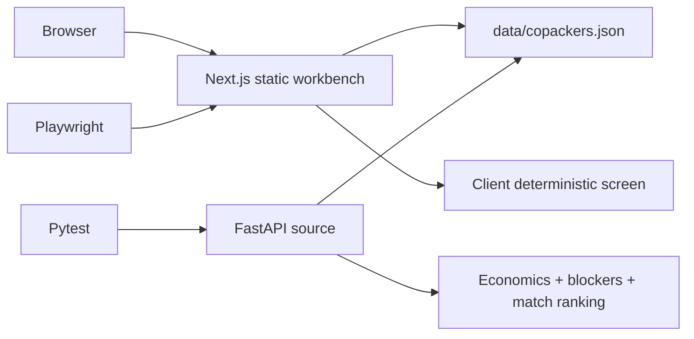
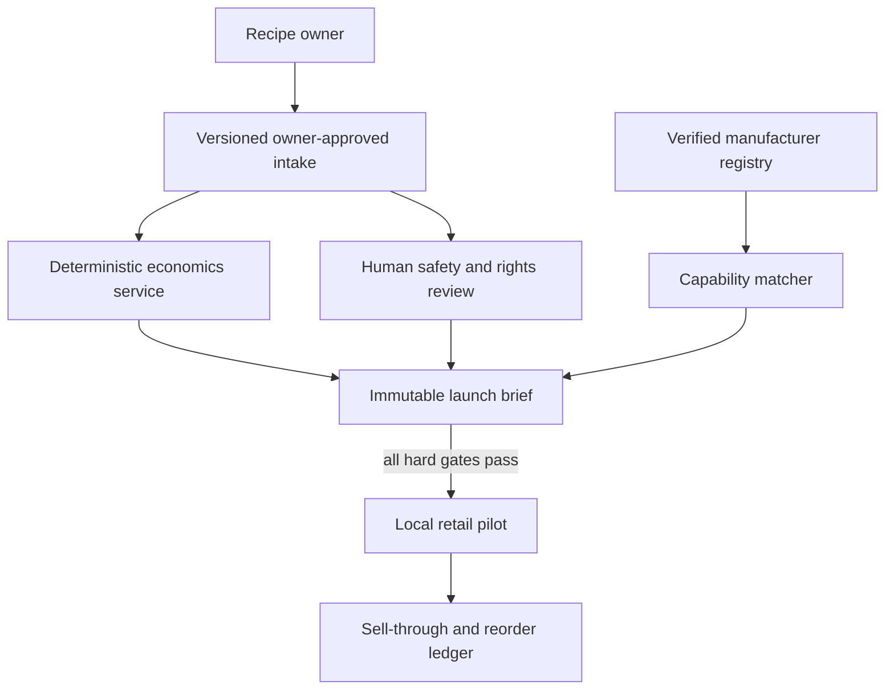

# Architecture

## Demo topology

GitHub Pages hosts only the frontend. FastAPI is runnable and tested source, not a public backend. No recipe, vendor request, order, certification, or payment is stored.

## Data paths and named errors

1. **Happy:** valid recipe and positive assumptions → margin, contribution, first-run cash, blockers, and ranked fictional matches.
2. **Nil/empty/wrong type:** browser validation or strict Pydantic `422`; no calculation.
3. **Impossible economics:** retail price not above unit cost → `retail_price_must_exceed_unit_cost`; browser names the correction.
4. **Weak launch:** low margin, short shelf life, budget gap, or no matching MOQ → explicit blockers, never an implied approval.
5. **Slow/double action:** action disables during calculation; changed inputs clear stale results.
6. **No match:** empty-state guidance appears; the API returns an empty list plus `no_demo_copacker_match`.

## Production boundary

Encrypt recipe versions, separate story assets from formulation, scope access by launch, log every read and export, and require dual approval for external sharing. Track screen latency, calculation version, cost variance, verification age, blocker frequency, outreach response, pilot sell-through, return rate, and reorder. Alert on access without owner approval, stale manufacturer claims, calculation drift, missing process authority, allergen-review gaps, or inventory exposure above approved cash.
